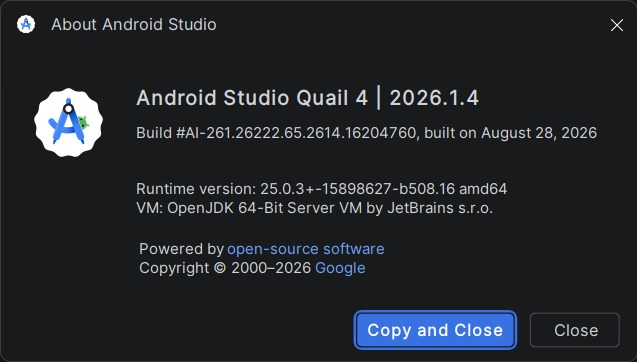
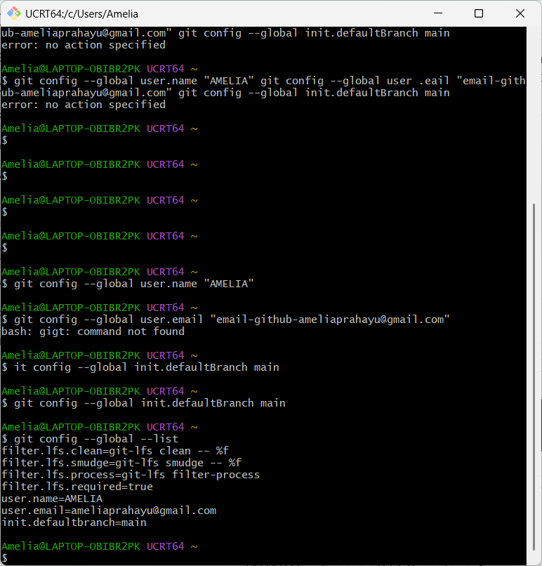

# Pertemuan 01 - Pengenalan Mobile Programming & Setup Lingkungan

## Ringkasan
Memasang Android Studio dan Git, membuat akun GitHub, membuat project
Trilogi (Kotlin, Jetpack Compose, Min SDK 24) yang menampilkan teks
"Hello Trilogi!", lalu mengunggahnya ke GitHub.

## Screenshot

### 1. Versi Android Studio (Help > About)

### 2. Git terpasang dan terkonfigurasi (Git Bash)

## Kode
- [MainActivity.kt](kode/MainActivity.kt)

## Bukti GitHub
- Repository: https://github.com/ameliaprahayu-dotcom/praktikum-mobile-trilogi
- Tag: https://github.com/ameliaprahayu-dotcom/praktikum-mobile-trilogi/tree/pertemuan-01

## Kendala & Solusi
| Kendala | Penyebab | Solusi |
|---|---|---|
| `error: no action specified` saat git config | Beberapa perintah tergabung dalam satu baris | Mengetik satu perintah per baris |
| Link tag menampilkan 404 | Ada titik di akhir URL yang ikut tersalin | Menghapus titik di akhir URL |