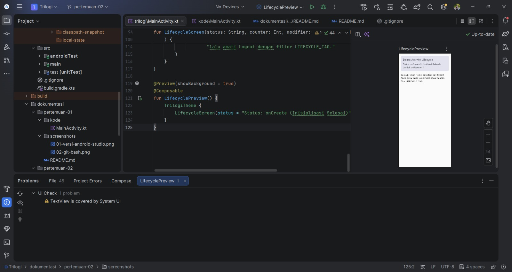
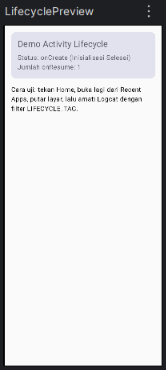

# Pertemuan 02 - Struktur Project, Activity & Lifecycle

## Ringkasan
Aplikasi menampilkan status lifecycle di layar, mencatat tiap callback ke
Logcat dengan tag LIFECYCLE_TAG, dan menghitung berapa kali onResume dipanggil.
Nilai counter ditampilkan lewat Toast.

## Screenshot

### 1. Kode MainActivity.kt dan struktur project di Android Studio

### 2. Tampilan UI (Preview)

## Cara Kerja
| Callback | Fungsi di aplikasi |
|---|---|
| onCreate | Inisialisasi Activity dan UI Compose |
| onStart | Layar mulai terlihat |
| onResume | Aplikasi aktif, resumeCount bertambah 1, Toast menampilkan nilainya |
| onPause | Aplikasi kehilangan fokus |
| onStop | Aplikasi di background |
| onRestart | Aplikasi dibuka kembali setelah onStop |
| onDestroy | Activity dihancurkan |

Setiap callback memanggil super.onXxx(), mencatat Log.d dengan tag
LIFECYCLE_TAG, lalu memperbarui teks status di layar.

## Kode
- [MainActivity.kt](kode/MainActivity.kt)

## Bukti GitHub
- Folder: https://github.com/ameliaprahayu-dotcom/praktikum-mobile-trilogi/tree/main/dokumentasi/pertemuan-02
- Tag: https://github.com/ameliaprahayu-dotcom/praktikum-mobile-trilogi/tree/pertemuan-02

## Kendala & Solusi
- Perintah PowerShell yang ditempel sekaligus saling tergabung. Solusi: menjalankan satu perintah per baris.