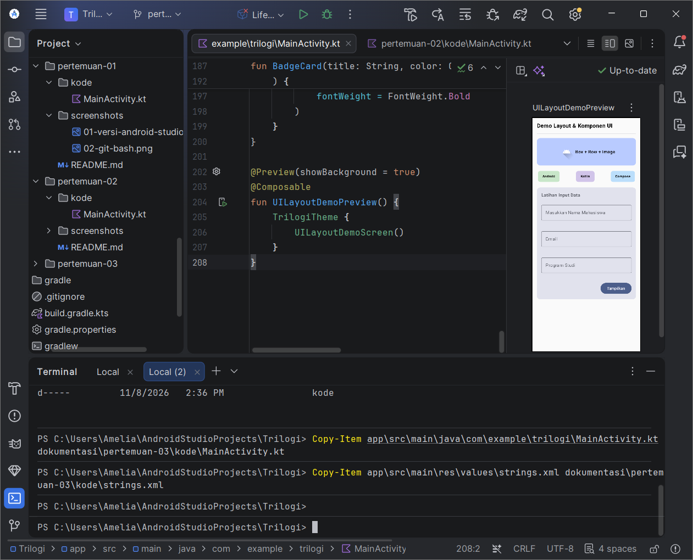
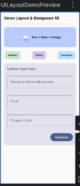

# Pertemuan 03 - Layout & Komponen UI

## Ringkasan
Layar demo Jetpack Compose yang memakai Column, Box, Row, Card, Image,
OutlinedTextField, dan Button. Penugasan mandiri: field Email dan Prodi,
validasi wajib isi (isError + supportingText), jarak 16dp antar elemen, dan
semua teks memakai String Resources (strings.xml).

## Screenshot

### 1. Kode layout di Android Studio

### 2. Tampilan UI (Preview)

## Komponen yang Dipakai
| Komponen | Fungsi |
|---|---|
| Column + verticalScroll | Susunan vertikal yang bisa digulir |
| Box + Image + Row | Kotak berlatar dengan gambar dan teks |
| Row (SpaceBetween) + BadgeCard | Tiga badge berwarna |
| Card + OutlinedTextField | Form Nama, Email, Prodi |
| Button | Memvalidasi isian dan menampilkan hasil |

## Penugasan Mandiri
- Field Email dan Prodi ditambahkan di samping field Nama.
- Validasi wajib isi: field kosong menampilkan pesan "Wajib diisi!" (isError + supportingText).
- Jarak antar elemen 16dp (padding 16.dp dan Arrangement.spacedBy(16.dp)).
- Semua teks UI diambil dari strings.xml lewat stringResource.

## Kode
- [MainActivity.kt](kode/MainActivity.kt)
- [strings.xml](kode/strings.xml)

## Bukti GitHub
- Folder: https://github.com/ameliaprahayu-dotcom/praktikum-mobile-trilogi/tree/main/dokumentasi/pertemuan-03
- Tag: https://github.com/ameliaprahayu-dotcom/praktikum-mobile-trilogi/tree/pertemuan-03

## Kendala & Solusi
- Ada beberapa file MainActivity.kt (arsip di folder dokumentasi). Solusi: mengedit hanya file di app/src/main/java.