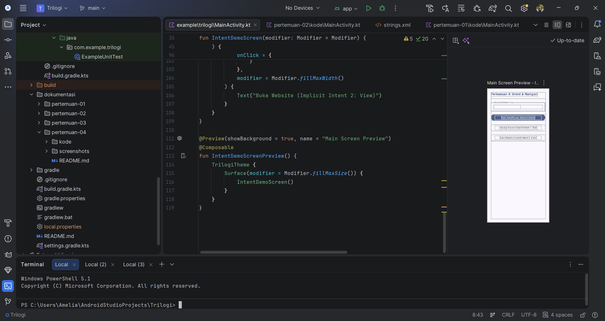
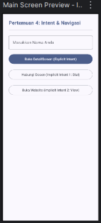

# Pertemuan 04 - Event Handling & Navigasi Antar-Screen (Intent)

## Ringkasan
Aplikasi Jetpack Compose dengan tiga layar (MainActivity, DetailActivity, SummaryActivity)
yang dihubungkan memakai Explicit Intent. Data dikirim dengan putExtra dalam tiga tipe
(String, Int, Boolean) dan diambil kembali dengan getStringExtra, getIntExtra, dan
getBooleanExtra beserta nilai default. Ditambahkan dua Implicit Intent: ACTION_DIAL
(membuka aplikasi telepon) dan ACTION_VIEW (membuka browser), keduanya diamankan
dengan try/catch ActivityNotFoundException.

## Alur Navigasi
- Layar 1 (MainActivity): input nama, tombol Explicit Intent, dan dua tombol Implicit Intent.
- Layar 2 (DetailActivity): menerima nama, semester, dan status aktif; tombol lanjut dan tombol finish().
- Layar 3 (SummaryActivity): menerima ketiga data dari Layar 2 dan menampilkannya.

## Screenshot

### 1. Kode Intent di Android Studio

### 2. Tampilan Layar 1 (Preview)

## Komponen yang Dipakai
| Komponen | Fungsi |
|---|---|
| Explicit Intent | Navigasi internal ke DetailActivity dan SummaryActivity |
| putExtra / getXxxExtra | Kirim dan ambil data String, Int, Boolean berdasarkan key |
| ACTION_DIAL | Membuka aplikasi telepon dengan nomor tujuan |
| ACTION_VIEW | Membuka website di browser |
| Elvis (?:) dan ifBlank | Nilai default "Guest" bila data kosong atau null |
| finish() | Menghapus Activity dari back stack |
| try / catch | Mencegah crash bila tidak ada aplikasi pemroses |
| AndroidManifest.xml | Mendaftarkan DetailActivity dan SummaryActivity (exported=false) |

## Kode
- [MainActivity.kt](kode/MainActivity.kt)
- [DetailActivity.kt](kode/DetailActivity.kt)
- [SummaryActivity.kt](kode/SummaryActivity.kt)
- [AndroidManifest.xml](kode/AndroidManifest.xml)

## Bukti GitHub
- Folder: https://github.com/ameliaprahayu-dotcom/praktikum-mobile-trilogi/tree/main/dokumentasi/pertemuan-04
- Tag: https://github.com/ameliaprahayu-dotcom/praktikum-mobile-trilogi/tree/pertemuan-04

## Kendala & Solusi
- DetailActivity.kt dan SummaryActivity.kt sempat terbuat di folder root repositori sehingga muncul
  error Unresolved reference 'DetailActivity'. Solusi: memindahkan kedua file ke
  app/src/main/java/com/example/trilogi/ lalu Rebuild Project.