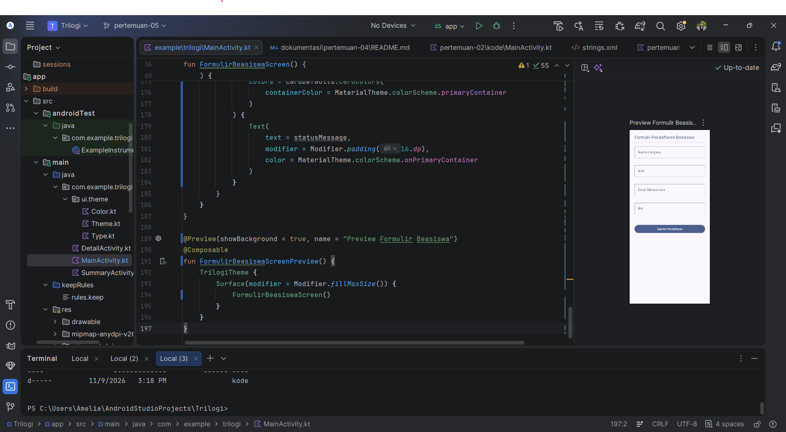
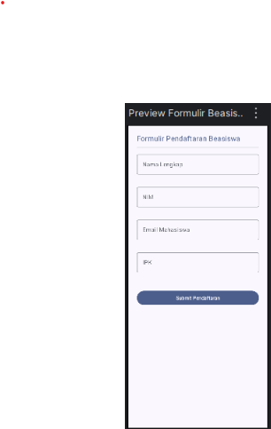

# Pertemuan 05 - Input Validation & State Management

## Ringkasan
Formulir pendaftaran beasiswa dengan input Nama, NIM (angka 8-10 digit), Email, dan IPK
(0.00 - 4.00). Setiap field punya pesan error spesifik (isError + supportingText), email
divalidasi dengan Patterns.EMAIL_ADDRESS, dan IPK dikonversi aman dengan toDoubleOrNull()
(koma desimal diterima). Seluruh state memakai rememberSaveable (padanan onSaveInstanceState
di Compose) agar data tidak hilang saat layar diputar, dan pesan error hilang saat pengguna
mulai mengetik (instant feedback).

## Screenshot

### 1. Kode di Android Studio

### 2. Tampilan formulir (Preview)

## Komponen yang Dipakai
| Komponen | Fungsi |
|---|---|
| rememberSaveable | State form tetap ada saat rotasi layar |
| OutlinedTextField + KeyboardOptions | Input Nama, NIM, Email, IPK sesuai tipe keyboard |
| isError + supportingText | Pesan error spesifik per field |
| Patterns.EMAIL_ADDRESS | Validasi format email |
| toDoubleOrNull() | Konversi IPK tanpa risiko crash, rentang 0.00 - 4.00 |
| Validasi NIM | Hanya angka dan panjang 8 sampai 10 digit |
| Card + verticalScroll | Menampilkan hasil dan membuat form dapat digulir |

## Kode
- [MainActivity.kt](kode/MainActivity.kt)

## Bukti GitHub
- Folder: https://github.com/ameliaprahayu-dotcom/praktikum-mobile-trilogi/tree/main/dokumentasi/pertemuan-05
- Tag: https://github.com/ameliaprahayu-dotcom/praktikum-mobile-trilogi/tree/pertemuan-05

## Kendala & Solusi
- (tulis kendala yang benar-benar kamu alami; hapus bagian ini jika tidak ada)