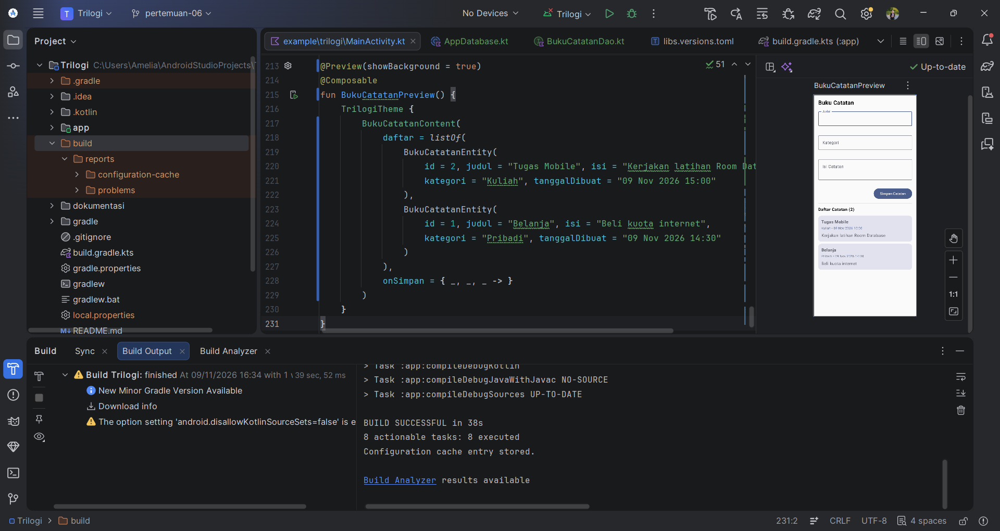
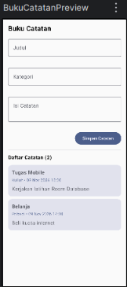

# Pertemuan 06 - Penyimpanan Data Lokal & Room Database Dasar

## Ringkasan
Aplikasi Buku Catatan dengan Room Database. Tabel buku_catatan menyimpan id,
judul, isi, kategori, dan tanggal_dibuat. Fitur: INSERT catatan dari form
(dengan validasi wajib isi) dan READ otomatis saat layar tampil lewat
LaunchedEffect, sehingga data tetap ada setelah aplikasi ditutup.

## Screenshot

### 1. Kode Room dan struktur project di Android Studio

### 2. Tampilan UI (Preview)

## Komponen Room
| Komponen | Peran |
|---|---|
| BukuCatatanEntity (@Entity) | Struktur satu tabel buku_catatan |
| BukuCatatanDao (@Dao) | insertCatatan dan getAllCatatan (suspend) |
| AppDatabase (@Database) | Gerbang database, dibuat sebagai Singleton (@Volatile + synchronized) |
| Dispatchers.IO / Main | Database dijalankan di background, UI diperbarui di main thread |
| KSP | Memproses anotasi Room saat build |

## Kode
- [MainActivity.kt](kode/MainActivity.kt)
- [BukuCatatanEntity.kt](kode/BukuCatatanEntity.kt)
- [BukuCatatanDao.kt](kode/BukuCatatanDao.kt)
- [AppDatabase.kt](kode/AppDatabase.kt)
- [libs.versions.toml](kode/libs.versions.toml)
- [app-build.gradle.kts](kode/app-build.gradle.kts)

## Bukti GitHub
- Folder: https://github.com/ameliaprahayu-dotcom/praktikum-mobile-trilogi/tree/main/dokumentasi/pertemuan-06
- Tag: https://github.com/ameliaprahayu-dotcom/praktikum-mobile-trilogi/tree/pertemuan-06

## Kendala & Solusi
- Nama file Entity sempat salah ketik (BukuCatatanEntitiy.kt) sehingga perintah salin gagal. Solusi: mengganti nama file dengan Rename-Item.
- Commit setup Gradle sempat masuk ke branch main. Solusi: memindahkan commit ke branch pertemuan-06 dengan git branch -f.
- Preview menampilkan Render problem setelah kode diganti. Solusi: Clean dan Rebuild Project, lalu Build & Refresh pada Preview.
- Perintah gradlew di Terminal gagal karena JAVA_HOME belum diatur. Solusi: build dilakukan dari dalam Android Studio.