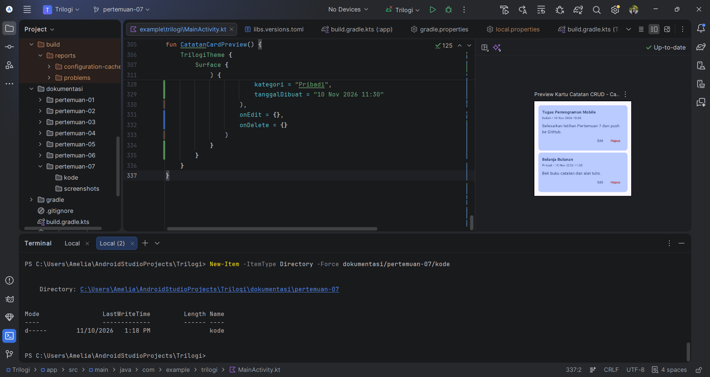
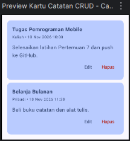

# Pertemuan 07 - CRUD Lanjutan & Pengelolaan Model Data

## Ringkasan
Aplikasi Buku Catatan dilengkapi CRUD penuh dengan Room. DAO ditambah @Update, @Delete, dan
query deleteById. Aplikasi mendukung mode tambah dan mode edit (state idEdit), daftar dinamis
memakai LazyColumn (padanan RecyclerView) dengan key id, serta dialog konfirmasi sebelum
menghapus (state idHapus) sebagai defensive UX. Operasi tulis dijalankan di Dispatchers.IO dan
daftar dimuat ulang setelahnya. Tanggal dibuat dipertahankan saat catatan diperbarui, dan form
di-reset bila catatan yang sedang diedit dihapus.

## Screenshot

### 1. Kode di Android Studio

### 2. Tampilan kartu catatan dengan tombol Edit dan Hapus (Preview)

## Komponen yang Dipakai
| Komponen | Fungsi |
|---|---|
| @Update | Memperbarui baris berdasarkan Primary Key (id) |
| @Delete / deleteById | Menghapus berdasarkan objek atau berdasarkan id |
| Mode tambah / edit | State idEdit mengubah judul layar dan label tombol |
| AlertDialog | Konfirmasi hapus (state idHapus) dengan tombol Batal dan Ya, Hapus |
| LazyColumn + key = id | Daftar dinamis, peran mirip RecyclerView + DiffUtil |
| Callback onEdit / onDelete | Lambda dari CatatanCard, setara lambda pada Adapter |
| Dispatchers.IO | insert, update, delete di background thread |
| muatUlang() | Membaca ulang daftar dari Room setelah tiap operasi |

## Kode
- [MainActivity.kt](kode/MainActivity.kt)
- [BukuCatatanDao.kt](kode/BukuCatatanDao.kt)
- [BukuCatatanEntity.kt](kode/BukuCatatanEntity.kt)
- [AppDatabase.kt](kode/AppDatabase.kt)

## Bukti GitHub
- Folder: https://github.com/ameliaprahayu-dotcom/praktikum-mobile-trilogi/tree/main/dokumentasi/pertemuan-07
- Branch: https://github.com/ameliaprahayu-dotcom/praktikum-mobile-trilogi/tree/pertemuan-07

## Kendala & Solusi
- (tulis kendala yang benar-benar kamu alami; hapus bagian ini jika tidak ada)